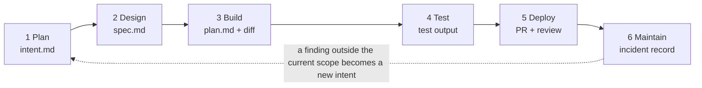

# What the AI-native SDLC playbook teaches Factory

Research · 2026-11-02 · design artifact of factory-sdlc-pipeline

> **Prompt:** Check out the AI-native SDLC playbook. I want the same pipeline: intent → design → plan → build → test. First extract knowledge and tips and tricks from this article.

Your reading of the pipeline matches the playbook for the stages you named. It differs in three places: Design is a written spec as well as mocks, testing runs *during* build as well as after, and the playbook continues past Test into Review/Deploy and Maintain. Maintain feeds new intents back into the start of the loop.

Sections: [The loop](#1-the-loop) · [Principles](#2-principles) · [Stage by stage](#3-stage-by-stage) · [Tips and tricks](#4-tips-and-tricks) · [Your pipeline vs the playbook](#5-your-pipeline-vs-the-playbook) · [Measuring it](#6-measuring-it)

Source: [The AI-native SDLC playbook](https://claude.com/resources/articles/the-ai-native-sdlc-playbook) (Claude, 2026). The rest of this page paraphrases it. The Factory decisions that follow from it are in [DESIGN.md](../DESIGN.md).

## 1. The loop

Each stage ends by **committing an artifact**, and the next stage starts by reading it. An accepted intent starts design. An approved spec starts plan mode. A merged PR starts the pipeline. A breached production metric writes a new intent. You start each stage by hand at first. Later, each accepted artifact triggers the next gate, and people review what the agent flagged at the gates.

Stages 1 to 4 are the ones you named. Deploy and Maintain are the stages the playbook adds. The dotted edge is the feedback loop back to Plan.

## 2. Principles

| Principle | Meaning |
| --- | --- |
| The bottleneck has moved | Code is no longer the slow part. Intent capture, review and verification are. Put human attention there. |
| One committed artifact per stage | Version control holds the intent, spec, plan, diff, review findings and incident. Together they are the audit trail: who asked, what the agent produced, who approved it. |
| Gates over steps | Humans stay accountable for judgment calls. They review flagged concerns at the gates and don't have to drive every step. |
| Skills advise, hooks enforce | A skill makes violations rare. A deterministic hook or check makes them close to impossible. A policy that must always hold needs both. |
| One source of truth per artifact | Name one system as authoritative and have every other system link to it. When two systems must coexist, linking them is the minimum. |
| Give the agent a feedback loop | Tests, builds and screenshots let a session check its own work before a person sees it. Evidence comes from the toolchain, not from the agent's say-so. |

## 3. Stage by stage

| Stage | Artifact | Who writes / approves | Key move |
| --- | --- | --- | --- |
| **Plan** | `intent.md`: problem, proposed outcome, affected users and systems, constraints, open questions | The originator writes it with the agent. The product owner corrects and accepts it. | Capture the idea in the originator's own words, once. The agent asks the questions an analyst would. |
| **Design** | `spec.md`: requirements and design, with concerns flagged. For UI work, a mock. | The agent writes it. The product owner reviews it and routes each concern to the owner of the policy involved. | Requirements and design are done in one session, with policies applied while the spec is written, so they aren't discovered in a later review. |
| **Build** | `plan.md`, then the code and its tests | The agent writes the plan in read-only plan mode. The engineer interrogates and accepts it. | Nothing is coded before the plan is accepted. If the code departs from the plan, update the plan in the same commit. |
| **Test** | Test, build and screenshot output that the agent ran and pasted | The session verifies itself. A fresh-context verifier gives the final verdict. | Use quantifiable targets. For a bug, write the failing test first. Fix the code, never the test. |
| **Deploy** | The PR, with review findings ranked by severity | Agent review passes run first. A code owner approves through branch protection. | The agent that wrote the code can't approve it. The agent works up to the production gate and stops there. |
| **Maintain** | The incident record and a new `intent.md` | Deterministic detection invokes the agent. A human triages the result. | Findings go back through the pipeline as new intents. Every incident becomes an eval. |

## 4. Tips and tricks

### Intent

- Describe the problem in plain language: what you can't do today, who it affects, what better looks like, what is out of scope.
- Keep brainstorming until the idea is concrete. The agent covers scope, users, constraints and success criteria, as an analyst would.
- Use one agreed template, encoded as a skill. Keep it short: problem, outcome, users/systems, constraints, open questions.
- The human corrects what the agent misunderstood *before* the intent is committed. The commit records the author and timestamp.

### Design

- Give the agent the intent and ask for a spec that fits the existing codebase. Ask it to **name areas of concern explicitly**, especially where two policies contradict each other.
- Load the policies (brand, security, compliance, UX) as skills while the spec is written.
- The reviewer resolves flagged concerns first, then checks two things: does the spec solve the stated problem, and has every open question from the intent been answered or carried forward?
- Commit the spec next to the intent. Together they record what was asked and what was decided.
- For UI work, mock the design from the intent and iterate on the mock before anyone writes code.

### Plan

- Plan in read-only mode. The plan names **the files that change, the order of work, and the tests that prove it**.
- Interrogate the plan: what could this break, which step is riskiest, and which options were rejected and why?
- The plan is done when an engineer who never saw the conversation could implement the change from the plan alone.
- With a solid plan, implementation often takes a single pass.
- Commit the plan. Review later checks the diff against it.

### Build

- When the work departs from the plan, update the plan in the same commit. A hook can enforce this.
- Keep project memory under a page: commands, the conventions that matter, and what the agent keeps getting wrong. **A mistake made twice goes into the memory file.**
- Write a skill for institutional knowledge that must be applied consistently. Test that it triggers by phrasing the task several ways.
- Keep build hooks fast and scoped to the changed file. Run heavy checks at the commit or the PR. Approval prompts belong at deploy gates, not mid-build, where they would stall every parallel session.
- Run parallel sessions in separate worktrees, and split the work by file. Start with 2–3 sessions. The real limit is how many streams one person can review properly.
- Turn recurring jobs into subagents: a simplifier, a verifier, a researcher. A verifier only reports. It doesn't fix.

### Test

- Make every check a single command that exits non-zero on failure. Document what healthy output looks like.
- State quantifiable targets, such as "all tests in X pass", "the screenshot matches the mock" or "the endpoint returns 200 with field F".
- **For a bug, write the failing test first.** Confirm it fails for the expected reason and commit it. Then make it pass without editing the test.
- For UI work: implement, screenshot, compare with the mock, adjust. Two or three rounds is normal.
- Verification is part of "done": run the checks and paste their output. If a test fails, fix the code, not the test.
- Do the final check in a fresh context so the verdict isn't colored by the assumptions that produced the code. The feedback loop runs throughout the task. The verifier runs once, at the end.
- Evals: collect 20–50 real tasks. Rerun them whenever the agent's configuration (memory, skills, hooks) changes. Every incident adds an eval.

### Review, deploy and maintain (beyond your five stages)

- Keep the review policy in a file with separate passes for bugs, security, and compliance with the spec and plan. Define Important versus Nit, cap nits at about five, and skip generated files and anything CI already enforces.
- When review flags the same mistake a second time, it goes into project memory.
- Grade autonomy by environment. The agent can deploy freely to dev. In production it prepares the release and a human authorizes it. Rollback should be the most rehearsed path.
- Keep detection deterministic. The model diagnoses only after a threshold is breached. Use tiers: log, then diagnose read-only, then propose a fix as a PR. Every result enters as a new intent.

## 5. Your pipeline vs the playbook

| Your stage | Your understanding | Playbook | Verdict |
| --- | --- | --- | --- |
| Intent | Close to the current brief. Requirements from the human. | `intent.md`: what, why, constraints, open questions, in the originator's words | **same.** It should be shorter than today's brief. |
| Design | AI-generated artifacts: mocks, images | A requirements-and-design spec with flagged concerns. A mock for UI work. | **wider.** Design also holds the decisions and concerns, not only mocks. |
| Plan | Agent-facing. Says up front what the tests will test. | `plan.md`: files, order, tests that prove it, risks. Accepted before any code. | **same.** The playbook adds an interrogation step and "commit the plan before the code". |
| Build | No spec. A debrief of how it went, abnormalities, lessons. | Implement, update the plan when the code drifts, feed mistakes back into project memory | **same.** Add: plan drift is fixed in the same commit, and repeated mistakes become memory updates. |
| Test | Cheap tests pass during build. Heavy tests only here. | A feedback loop during build, then a fresh-context verifier, then review passes | **same.** Add a fresh-context verifier and a compliance review against intent, design and plan. |
| None | None | Deploy and Maintain | **missing.** Factory doesn't deploy. Keep only the loop-back: findings outside the scope become draft intents. |

## 6. Measuring it

The playbook measures each stage from git timestamps and PR metadata. These measures fit Factory because every stage commits a document:

- **Intent survival:** the share of intents accepted rather than closed, and how often an intent changes after design starts.
- **Spec rework:** design edits made after the plan was committed.
- **First-pass build:** the share of tasks whose build passes the planned tests in one pass, and how closely the final diff matches the plan.
- **Escape rate:** defects found in Test or later that the planned tests should have caught.
